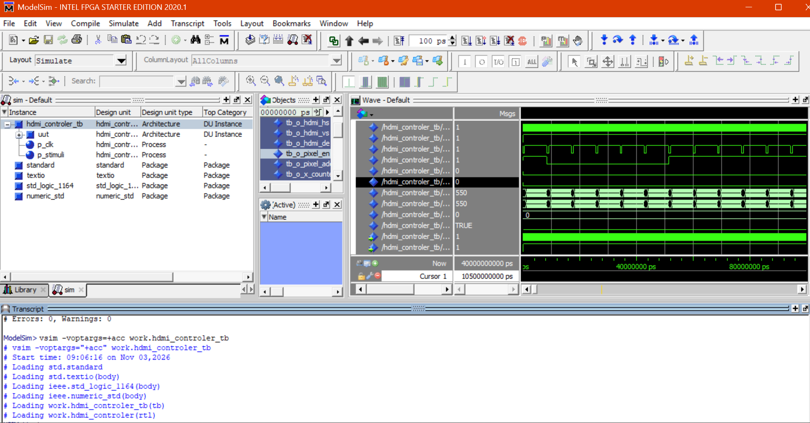
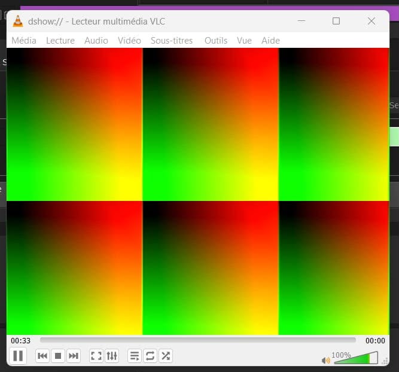

# TP FPGA – Affichage HDMI

## Objectif

Afficher une image en 720 × 480 pixels à partir de la carte DE10-Nano, puis visualiser le signal HDMI dans VLC à l'aide d'un adaptateur HDMI-USB.

## Fichiers utilisés

- `telecran.vhd` : fichier principal, reliant la PLL, le contrôleur HDMI et la configuration I2C.
- `hdmi_controler.vhd` : génération des signaux HS, VS, DE et des coordonnées des pixels.
- `I2C_HDMI_Config.v` : configuration du transmetteur HDMI ADV7513.
- `pll` : génération d'une horloge de 27 MHz à partir de 50 MHz.
## Simulation Modelsim




## Principe

Le contrôleur HDMI parcourt les pixels de l'image et génère les signaux de synchronisation horizontale (`HS`), verticale (`VS`) et d'activation de l'affichage (`DE`).

Dans `telecran.vhd`, les couleurs sont calculées à partir des coordonnées :

```vhdl
o_hdmi_tx_d(23 downto 16) <= std_logic_vector(to_unsigned(s_x_counter, 8));
o_hdmi_tx_d(15 downto 8)  <= std_logic_vector(to_unsigned(s_y_counter, 8));
o_hdmi_tx_d(7 downto 0)   <= (others => '0');
```

- Rouge : coordonnée X.
- Vert : coordonnée Y.
- Bleu : valeur 0.

Comme les couleurs sont codées sur 8 bits, leurs valeurs se répètent tous les 256 pixels. On s'attend donc à voir 3 zones dans la largeur et 2 dans la hauteur.

## Étapes

1. Compiler le projet dans Quartus.
2. Programmer la carte DE10-Nano.
3. Relier la sortie HDMI à l'adaptateur HDMI-USB.
4. Ouvrir le périphérique de capture dans VLC.


## Résultat de l'affichage HDMI

L'image obtenue présente 6 zones colorées (3 colonnes et 2 lignes).




Cette image illustre le rendu visé. La validation du fonctionnement sur la carte utilisée reste à confirmer.


